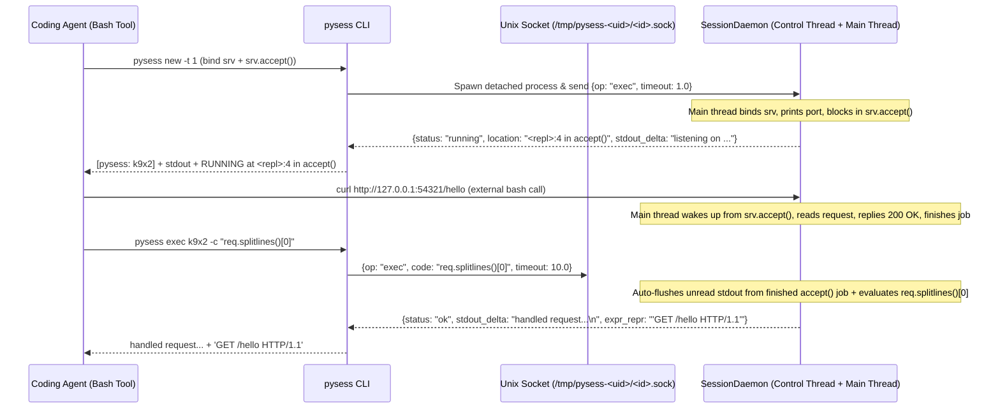

# `pysess`: Persistent Python Sessions for Coding Agents

## Problem Statement

When a coding agent runs Python through a stateless `bash` tool (`python3 -c "..."`), every invocation starts a new interpreter process and exits immediately. For multi-step debugging, protocol testing, and stateful client/server workflows, this causes three problems:

1. **Loss of in-memory state and live descriptors:** Sockets, HTTP sessions, database connections, imports, and parsed data disappear as soon as `python3 -c` exits.
2. **Inability to coordinate blocking calls across bash turns:** If an agent creates a server socket and calls `srv.accept()` in a stateless bash call, the bash tool blocks until it times out and kills the process—making it impossible for the agent to start a blocking listener in Turn 1, send traffic to it with `curl` in Turn 2, and inspect the received data in Turn 3.
3. **Opaque hangs:** When a Python call blocks or takes longer than expected, standard `python3 -c` gives no visibility into *which* line or function is blocked and no way to interrupt the stuck call without destroying the entire Python process and its in-memory state.

`pysess` solves these problems as a zero-dependency Python CLI package using only the Python standard library (`src/pysess/`).

---

## 1. Core Design Decisions & Findings

### 1.1 Ephemeral Session IDs (`new` $\rightarrow$ `<id>`, `exec <id>`)
- `pysess new` spawns a background interpreter daemon, allocates a short random session ID (such as `k9x2`), optionally runs initial code in the same turn, and prints `[pysess: k9x2]`.
- Subsequent commands pass `<id>` positionally (`pysess exec k9x2 ...`).
- **Parallel sessions = separate OS processes:** Every `pysess new` launches an independent `sys.executable` process with its own GIL, memory space, and Unix domain socket (`<id>.sock`). Multiple agents or subagents can run sessions in parallel without colliding.
- **Context-reset immunity:** If the LLM context window is compacted or cleared, the agent does not know stale session IDs and naturally starts a clean session with `pysess new`.
- **Crash visibility:** If a session daemon dies or expires, `pysess exec k9x2` fails immediately with a clear error instead of silently executing in an empty namespace.

### 1.2 Why Soft-Timeout Detach Beats Hard Timeouts and Heuristic Auto-Detach
We evaluated three models for handling slow or blocking calls:

1. **Hard timeout (`SIGALRM` aborting the step at `-t SEC`):**
   - *Why it fails for multi-turn workflows:* If Turn 1 runs `conn, addr = srv.accept()`, a hard timeout aborts `accept()` with `TimeoutError` when returning control to the bash tool. By the time the agent runs `curl` in Turn 2, nothing is listening in `accept()` anymore.
2. **Heuristic "frame-freeze" auto-detach (detaching after 0.5s of stationary bytecode):**
   - *Why it fails for client RPCs:* At the OS/frame level, a client waiting 0.8s for an HTTP/MCP response inside `socket.recv()` looks identical to a deadlocked reader inside `socket.recv()`. Detaching after 0.5s of stationary frames causes normal 600ms client calls to detach prematurely, forcing the agent to waste extra LLM turns calling `wait`.
3. **Soft-timeout detach with live frame location (Chosen Design):**
   - Steps wait up to `-t SEC` (accepts fractional seconds such as `-t 0.2`; default `10s`). Agents can pass `-t 0.2` when intentionally starting a blocking wait like `srv.accept()`.
   - If the step is still running when `-t` expires, the daemon **keeps the step running on the Main Thread** and detaches the CLI client, reporting the exact `<repl>` line and function where the main thread is currently parked via `sys._current_frames()`:
     ```text
     [pysess: k9x2 | RUNNING (0.2s) at <repl>:4 in accept() - use 'pysess wait k9x2' or 'pysess cancel k9x2']
     ```

### 1.3 Why User Code Must Run Sequentially on the Main Thread (CPython PEP 475)
A critical finding from CPython internals (`Python/ceval.c` and PEP 475) drives the daemon's threading model:
- Since Python 3.5 (PEP 475), CPython automatically retries interrupted C syscalls (`socket.accept`, `socket.recv`, `os.read`, `select`, `time.sleep`, `lock.acquire`) inside C on `EINTR` **unless** `PyErr_CheckSignals()` returns `-1`.
- In CPython, **`PyErr_CheckSignals()` is a no-op on every thread except the Main Thread** (`if (!_PyOS_IsMainThread()) return 0;`). Even `PyThreadState_SetAsyncExc` combined with `pthread_kill(worker_tid, SIGINT)` cannot break a worker thread out of `srv.accept()` or `os.read()`.
- Furthermore, running concurrent `exec` threads against a single shared namespace risks corrupting non-thread-safe client objects (HTTP sessions, DB cursors, stdio pipes).
- **Design rule:** Every `SessionDaemon` executes user code strictly one step at a time on its **Main Thread**, while a lightweight **Control Thread** serves the Unix domain socket and uses `signal.pthread_kill(main_tid, signal.SIGINT)` to reliably interrupt blocking C calls on `cancel` or `kill`.

### 1.4 Zero-Turn Penalty When Coming Back After a Blocking Call Finishes
When a detached step (such as `srv.accept()`) finishes in the background after an external command (like `curl`) connects to it:
- The agent does **not** need to spend an extra turn calling `pysess wait <id>` before running its next `pysess exec <id>`.
- When `pysess exec <id>` arrives and the previous detached job has already completed, its **unread `stdout`/`stderr` is returned together with the new step's output**. The daemon keeps one read position per stream for the whole session (see 1.8), so output not yet delivered to a client, including output a background process wrote after its step finished, is returned by the next `exec` or `wait`.

### 1.5 Authentic `__main__` Module & Context-Window Guardrails
- **Real `sys.modules["__main__"]` backing:** The session namespace is backed by a genuine `types.ModuleType("__main__")` registered in `sys.modules["__main__"]` with `__builtins__ = builtins` (the module, not a `dict`). This ensures standard library tools that resolve symbols via `sys.modules[cls.__module__]`—such as `dataclasses` with `from __future__ import annotations`, `typing.get_type_hints()`, `pickle`, and `inspect`—work identically to standard Python.
- **Jupyter-cell trailing expression + 32 KB `repr()` truncation:** If the final statement of a step is an expression evaluating to a non-`None` value, `pysess` binds `_ = value` and prints `repr(value)`. Auto-printed `repr()` outputs larger than 32 KB are truncated with a hint that the full object is stored in `_` (explicit `print()` calls are never truncated).
- **Clean tracebacks:** Internal `pysess` frames are stripped so tracebacks always start at `File "<repl>", line N`.

### 1.6 Signal Race, Shutdown, and Socket Security Hardening
- **Guarded `SIGINT` handler:** The main thread installs a custom `SIGINT` handler that only raises `KeyboardInterrupt` while `self._in_user_code` is `True` (paired with a `job.cancel_requested` pre-check). This eliminates the race window where a late `SIGINT` from `cancel` arrives just as a job finishes and crashes the daemon loop.
- **Deterministic `kill` with watchdog:** `pysess kill` unlinks the socket immediately, interrupts any running job on the main thread, and starts a 0.5s fallback watchdog (`atexit._run_exitfuncs()` + `os._exit(0)`) in case user code traps `BaseException`.
- **`SystemExit` delivery synchronization:** If user code calls `sys.exit(...)`, the main thread waits on `job.delivered_event` so the control thread finishes writing the socket response before the daemon process exits.
- **Socket & runtime directory security:** `runtime_dir()` verifies via `lstat()` that the socket directory is a real directory (not a symlink), is owned by `os.getuid()`, and has `0o700` permissions. `socket_path()` validates session IDs against `^[a-zA-Z0-9][a-zA-Z0-9_-]{0,31}$` to prevent path traversal.
- **Default runtime directory `/tmp/pysess-<uid>`:** Like tmux's `/tmp/tmux-<uid>`. `$XDG_RUNTIME_DIR` (`/run/user/<uid>`) was rejected because it also holds keyring, gpg-agent, D-Bus, and audio sockets: a sandboxed agent would need write access there just so pysess can create its subdirectory. In the shared `/tmp`, the ownership and mode checks above mean another user can at most create the path first, so pysess refuses to start, but cannot read or plant files in it. `/tmp` is hard-coded rather than taken from `$TMPDIR`, so a sandbox and the user's terminal agree on the location. `PYSESS_RUNTIME_DIR` overrides it.

### 1.7 Runtime Package Installation (`pysess.venv`)
Agents often need a third-party package mid-session, but must not write to user-wide locations (`~/.local/lib/python*/site-packages`, the `uv tool` environment of pysess itself).

- **Python API, not CLI:** Inside a session, `import pysess` returns the package the daemon already runs from. `pysess.venv` functions run as ordinary user code on the main thread, so they get output capture, `-d`/`wait`/`cancel`, and composability (`try: import x except ImportError: install(...)`) for free, and `sys.path` is never mutated concurrently with user code. The CLI only has `pysess venv ls`/`rm` to manage venvs when no session is running.
- **Overlay instead of re-spawning:** The daemon keeps running on the pysess interpreter. A venv is created with `uv venv --python sys.executable`, populated with `uv pip install --python <venv>/bin/python`, and attached with `site.addsitedir()` + `importlib.invalidate_caches()`. This allows installing into, and switching venvs of, a running session. uv has no library API, so it is invoked as a subprocess with its output written to the session's stderr.
- **Attaching details:**
  - Entries added by `addsitedir` (the venv's `site-packages` and paths added by its `.pth` files) are recorded and moved before the interpreter's own site-packages, so the venv takes precedence. `detach()` removes exactly those entries.
  - `<venv>/bin` is prepended to `PATH` and `VIRTUAL_ENV` is set so subprocesses running `python` use the venv; `sys.executable` is not changed. `detach()` removes only that `PATH` entry and restores `VIRTUAL_ENV` only if it still points at the venv, so other environment changes are kept.
  - Code executed by `.pth` files and modules already imported cannot be unloaded; `detach()` and switching print the top-level modules that remain loaded.
- **Private vs. shared:** `use()` (or `install()` with no venv attached) creates and attaches the session's private venv (`sessions/<id>/venv`). The daemon deletes it after its main loop exits (so `kill` is answered first), and on start of a session with the same ID (left over after `SIGKILL`). `use(name)` attaches a shared venv (`venvs/<name>`) that outlives sessions until `remove()`/`pysess venv rm`. Venvs always live in the runtime directory, so session IDs, and therefore private venvs, cannot collide.
- **Deliberately unguarded:** Installing into or removing a shared venv affects every session using it; there is no cross-session in-use check or locking. Sharing is opt-in, `uv pip install` locks the venv itself so concurrent installs cannot corrupt it, `uv venv --allow-existing` tolerates concurrent creation, and the worst case for another session is a failed or mismatched import. The one guard kept is the interpreter check: a venv is attached only if `realpath(<venv>/bin/python) == realpath(sys.executable)`, since compiled extensions built for another Python crash or misbehave.

```text
<runtime dir>/             0700
  <id>.sock                session sockets
  venvs/<name>/            shared venvs
  sessions/<id>/venv/      private venv of session <id>
```

### 1.8 Output Capture on File Descriptors 1 and 2
Redirecting `sys.stdout`/`sys.stderr` only captures Python-level writes. Child processes (`subprocess.run()`, `os.system()`, subprocesses started by libraries) and C code write to file descriptors 1 and 2, which pointed to `/dev/null`, so their output was silently lost and looked like a command that printed nothing.

- **Unlinked files instead of pipes:** At start, the daemon points descriptors 1 and 2 at two files created with `tempfile.TemporaryFile()` (`O_TMPFILE`, no name in the runtime directory) in append mode. Responses read new output with `os.pread()` from a per-stream read position. A pipe would need a reader thread and an end-of-step marker to know all output has arrived, and blocks every writer once the reader stops. With a file, everything written by a finished step is already there, and writers never block.
- **One stream shared by Python and child processes:** The daemon runs with `python -u`, so `sys.stdout`/`sys.stderr` write straight to the descriptors without buffering, and the order between Python output and child process output is kept. `sys.__stdout__` and `sys.stdout.buffer` work as in a normal interpreter. Reassignments of `sys.stdout`/`sys.stderr` are undone after each step, and pysess writes tracebacks to the original `sys.stderr`.
- **Output after a step finished:** Background processes and threads keep writing to the same files. The output is returned by the next `exec` or `wait` (before that step's own output) and written to the session log before the next cell.
- **Lifetime:** The kernel frees the files when the last descriptor closes, so nothing is left behind even after `SIGKILL`. A child process that outlives the session keeps its file open until it exits. The files grow for the lifetime of the session; output read by clients is not truncated.
- **Limitations:** C code using stdio (`printf`) buffers output in the C library until it is flushed. The session log records each step's `stdout` followed by its `stderr`, not their interleaving.

---

## 2. Architecture & Multi-Turn Blocking Walkthrough



### Example: Blocking Server Socket + `curl` Across Turns

```bash
# Turn 1: Create a server socket and block on accept() (detaches after 0.2s)
pysess new -t 0.2 <<'EOF'
import socket
srv = socket.create_server(("127.0.0.1", 0))
print(f"listening on http://127.0.0.1:{srv.getsockname()[1]}", flush=True)
conn, addr = srv.accept()
req = conn.recv(4096).decode()
conn.sendall(b"HTTP/1.1 200 OK\r\nContent-Length: 2\r\n\r\nok")
conn.close()
print("handled request from", addr, flush=True)
EOF
# Output:
# [pysess: k9x2]
# listening on http://127.0.0.1:54321
# [pysess: k9x2 | RUNNING (0.2s) at <repl>:4 in accept() - use 'pysess wait k9x2' or 'pysess cancel k9x2']

# Turn 2: Send an HTTP request to the waiting server from bash
curl -s http://127.0.0.1:54321/hello

# Turn 3: Come back into session k9x2 and inspect `req`
# (The completed background print "handled request from ..." is flushed automatically)
pysess exec k9x2 -c "req.splitlines()[0]"
# Output:
# handled request from ('127.0.0.1', 54322)
# 'GET /hello HTTP/1.1'

# Turn 4: If a blocking call ever gets stuck because the client failed, interrupt it:
# pysess cancel k9x2  (raises KeyboardInterrupt in accept() while keeping `srv` alive)

# Turn 5: Clean up
pysess kill k9x2
```

---

## 3. CLI Interface & Package Layout

### 3.1 CLI Interface

```text
Usage: pysess <subcommand> [options]

Subcommands:
  new [-c CODE | FILE] [-t SEC]       Start a new session, optionally run code, and print session ID
  exec <id> [-c CODE | FILE] [-t SEC] Execute code in session <id> (reads stdin if no -c or FILE)
  wait <id> [-t SEC]                  Wait for a running background step in <id> (use -t 0 to poll)
  cancel <id>                         Interrupt the running step in <id> with KeyboardInterrupt
  ps [<id>]                           List active sessions (or inspect <id> state, location, and variables)
  kill [<id> | --all]                 Stop session(s) cleanly and remove socket files
  venv ls                             List venvs created with the pysess.venv Python API
  venv rm <name>... | --all           Remove shared venvs or orphaned private venvs
```

Default timeouts (`-t SEC` accepts fractional seconds, e.g. `-t 0.2`):
- `new` / `exec`: `-t 10` (10 seconds before detaching to background)
- `wait`: `-t 30` (30 seconds; `-t 0` for non-blocking poll)

### 3.2 Package Layout

- `src/pysess/cli.py`: CLI parser (`build_parser`), entrypoint (`main`), `SessionDaemon`, output capture, and AST evaluator.
- `src/pysess/_runtime.py`: Runtime directory and socket helpers, session request client, and `pysess.Error`, shared by the CLI and the Python API.
- `src/pysess/venv.py`: `pysess.venv` Python API for ephemeral virtual environments.
- `src/pysess/__main__.py`: Module entrypoint (`python -m pysess`).
- `src/pysess/__init__.py`: Public Python API (`pysess.venv`, `pysess.Error`); future controls get their own submodule.
